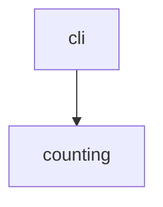

# troy-mode-trial architecture

troy-mode-trial is a scratch project for trying troy-mode out. It counts the words of a text, and its `wordcount` command does the same from a shell.

## 1. Background and constraints

- None beyond troy-mode's own rules.

## 2. Tech stack

| Part | Choice | Reason |
| --- | --- | --- |
| Language | Python 3.13 | troy-mode's Python pack. |
| Command-line program | The console script `wordcount = "troy_mode_trial.cli:main"` in the table `[project.scripts]` of `pyproject.toml`, built by hatchling, the existing build backend. The installer (uv or pip) makes `wordcount`, `wordcount.exe` on Windows, in the environment's scripts folder. | Works the same on Windows 11 and Linux, needs no second language, and adds no dependency (ADR-0001). |
| Argument parsing | The standard library's `argparse`. | Requirements 7 allow the standard library only (ADR-0001). |

## 3. Modules

| Module | Owns | External interfaces | May depend on |
| --- | --- | --- | --- |
| counting | `src/troy_mode_trial/__init__.py`, `src/troy_mode_trial/counting.py`. Counts the words of a text. A library: it writes no output and sets no exit code. | `src/troy_mode_trial/__init__.py` | None |
| cli | `src/troy_mode_trial/cli.py`. The command line of the wordcount program: reads the arguments, calls counting, writes the result or an error, and returns an exit code. | `src/troy_mode_trial/cli.py` | counting |

## 4. Dependency rules

- cli imports counting only through `src/troy_mode_trial/__init__.py`, never `src/troy_mode_trial/counting.py`.
- counting never imports cli. `src/troy_mode_trial/__init__.py` does not import `src/troy_mode_trial/cli.py`.
- No module imports cli. Its only caller is the console script.
- The Owns patterns of the modules do not overlap, so a file's module does not depend on the order of the rows. A design that adds a file under `src/troy_mode_trial/` names the module that owns it, and the module table adds the file in the same change flow.

## 6. Error handling

- **counting.** It lets Python's own exceptions reach the caller, such as `FileNotFoundError` or `UnicodeDecodeError`, and defines no exception of its own (requirements Q4).
- **cli.** It catches only the exceptions that counting documents for a file: `OSError` and its subclasses, and `UnicodeDecodeError`. For one of them it writes one line `wordcount: <FILE as typed>: <reason>` to standard error and returns exit code 2, because Troy's scripts treat code 2 as an error (ADR-0002).
- A wrong command line, such as no file or two files, exits with code 2 and a usage line on standard error, as `argparse` does.
- A file error and a wrong command line share exit code 2. Only the text on standard error tells them apart: the line `wordcount: <FILE as typed>: <reason>` for a file error, and a usage line for a wrong command line.
- Any other exception is a bug, and cli does not catch it. Python writes the traceback to standard error and exits with code 1, so code 1 means only a bug.
- On success, cli returns exit code 0.
- F04's design fixes the reason texts and the exact signature of `main`.

## 8. Naming and coding rules

- Standard output holds only the program's result. For `wordcount`, that is the count and one line break. Errors and usage lines go to standard error.
- cli writes with `sys.stdout.write` and `sys.stderr.write`, not `print()`. ruff's T20 rule stays on for the whole package, with no per-file exemption.

## 9. Third-party dependencies

None. The program uses the standard library only (requirements 7).

## 11. Decision records

| ADR | Title | Status |
| --- | --- | --- |
| ADR-0001 | The `wordcount` command lives in its own module, cli | Accepted. The exit code for a file error in point 4 of its decision is replaced by ADR-0002. |
| ADR-0002 | A file error in `wordcount` exits with code 2 | Accepted |

## 12. Change log

| Version | Date | Change |
| --- | --- | --- |
| 1.0 | 2026-11-07 | First version, with the module counting. Approved by Troy for troy-init's trial. |
| 1.1 | 2026-11-14 | For F04, the `wordcount` command (ADR-0001): the tech stack adds the console script in `[project.scripts]` and `argparse`. The module table adds cli, and counting's Owns narrows to its two files. New sections: dependency rules, error handling, the rule for standard output and `print()`, third-party dependencies, and decision records. |
| 2.0 | 2026-11-14 | Approved by Troy. |
| 2.1 | 2026-11-14 | Troy's change on PR #39 (ADR-0002): a file error in cli returns exit code 2 instead of 1, because Troy's scripts treat 2 as an error. Section 6 says that a file error and a wrong command line share code 2 and only the text on standard error tells them apart, and that an uncaught bug exits with code 1 through Python's traceback. The decision records list ADR-0001 as Accepted, with its exit code replaced by ADR-0002, and add ADR-0002. |
| 3.0 | 2026-11-14 | Approved by Troy. |
