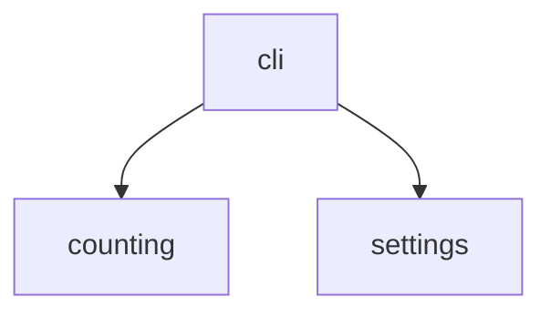

# troy-mode-trial architecture

troy-mode-trial is a scratch project for trying troy-mode out. It counts the words of a text, and its `wordcount` command does the same from a shell.

## 1. Background and constraints

- None beyond troy-mode's own rules.

## 2. Tech stack

| Part | Choice | Reason |
| --- | --- | --- |
| Language | Python 3.13 | troy-mode's Python pack. |
| Command-line program | The console script `wordcount = "troy_mode_trial.cli:main"` in the table `[project.scripts]` of `pyproject.toml`, built by hatchling, the existing build backend. The installer (uv or pip) makes `wordcount`, `wordcount.exe` on Windows, in the environment's scripts folder. | Works the same on Windows 11 and Linux, needs no second language, and adds no dependency (ADR-0001). |
| Argument parsing | The standard library's `argparse`. | Requirements 7 allow the standard library only (ADR-0001). |

## 3. Modules

| Module | Owns | External interfaces | May depend on |
| --- | --- | --- | --- |
| counting | `src/troy_mode_trial/__init__.py`, `src/troy_mode_trial/counting.py`. Counts the words of a text. A library: it writes no output and sets no exit code. | `src/troy_mode_trial/__init__.py` | None |
| cli | `src/troy_mode_trial/cli.py`. The command line of the wordcount program: reads the arguments, calls counting, writes the result or an error, keeps the run's option through settings, and returns an exit code. | `src/troy_mode_trial/cli.py` | counting, settings |
| settings | `src/troy_mode_trial/settings.py`. The settings file of the wordcount program: finds it, reads the saved option, and writes the option of a run (ADR-0003). It writes no output and sets no exit code. | `src/troy_mode_trial/settings.py` | None |

## 4. Dependency rules

- cli imports counting only through `src/troy_mode_trial/__init__.py`, never `src/troy_mode_trial/counting.py`.
- cli imports settings through `src/troy_mode_trial/settings.py`.
- counting never imports cli or settings. `src/troy_mode_trial/__init__.py` does not import `src/troy_mode_trial/cli.py` or `src/troy_mode_trial/settings.py`, and exports nothing from them, so the library writes no file (requirements 7).
- settings imports neither counting nor cli. Only cli imports settings.
- No module imports cli. Its only caller is the console script.
- The Owns patterns of the modules do not overlap, so a file's module does not depend on the order of the rows. A design that adds a file under `src/troy_mode_trial/` names the module that owns it, and the module table adds the file in the same change flow.

## 5. Data model

The program keeps one file, the settings file of `wordcount` (ADR-0003). counting keeps nothing.

- **Where.** On Windows (`sys.platform == "win32"`), `<APPDATA>\wordcount\settings.json`. Elsewhere, `<XDG_DATA_HOME>/wordcount/settings.json` when `XDG_DATA_HOME` is set to an absolute path, otherwise `~/.local/share/wordcount/settings.json` (requirements Q17). settings works the path out from the environment at each run and never caches it.
- **Content.** UTF-8 JSON: one object with exactly one key. Its value is `null` for a run with no counting option, or the name of one counting option. F08's design fixes the key and the values `lines`, `chars`, and `longest`. F09's design adds `sentences`.
- **What it never holds.** A file name, a path, a count, or text from a file (requirements Q18).
- **Invalid content.** Any other content, such as broken JSON, another key, an extra key, or an unknown value, is a settings file that cannot be read (requirements Q20). A missing file means no saved option.
- **When it is written.** Only by a run that printed a count, after the count and its line break are on standard output. A failed run leaves the file as it was (requirements Q19).
- **How it is written.** settings creates the `wordcount` folder when it is missing, writes the new content to a temporary file in the same folder, and replaces the old file with `os.replace`. A failed or interrupted write leaves the old file whole, or no file, and never a half-written one.
- **Compatibility.** The format outlives each version of the program. A design that changes it says how a newer version treats a file that an older version wrote, and changes this section through the change flow.

## 6. Error handling

- **counting.** It lets Python's own exceptions reach the caller, such as `FileNotFoundError` or `UnicodeDecodeError`, and defines no exception of its own (requirements Q4).
- **settings.** It defines no exception of its own. It lets `OSError` and its subclasses through, and raises `ValueError` for content that is not a saved option (`json.JSONDecodeError` is a `ValueError`). An unset `APPDATA` on Windows is a settings error, raised as one of these two types, not a bug (ADR-0003).
- **cli and counting.** Around its call to counting, cli catches only the exceptions that counting documents for a file: `OSError` and its subclasses, and `UnicodeDecodeError`. For one of them it writes one line `wordcount: <FILE as typed>: <reason>` to standard error and returns exit code 2, because Troy's scripts treat code 2 as an error (ADR-0002).
- **cli and settings.** cli catches `OSError` and `ValueError` only around its calls to settings, never around counting.
  - Reading the saved option for `--again`: no saved option, or a settings file that cannot be read, gives one error line that names the settings file on standard error and exit code 2 (requirements Q20). cli reads before it counts, so such a run prints no count.
  - Writing the option after a count: a failed write gives one warning line that names the settings file on standard error, and the exit code stays 0 (requirements Q22).
- A wrong command line, such as no file, two files, or `--again` together with a counting option, exits with code 2 and a usage line on standard error, as `argparse` does (requirements Q21).
- A file error, a settings error on `--again`, and a wrong command line share exit code 2. Only the text on standard error tells them apart: the line `wordcount: <FILE as typed>: <reason>` for a file error, a line that names the settings file for a settings error, and a usage line for a wrong command line.
- Any other exception is a bug, and cli does not catch it. Python writes the traceback to standard error and exits with code 1, so code 1 means only a bug.
- On success, cli returns exit code 0, also when the settings file could not be written.
- F04's design fixes the reason texts and the exact signature of `main`. F08's design fixes the texts of the settings error and the settings warning.

## 8. Naming and coding rules

- Standard output holds only the program's result. For `wordcount`, that is the count and one line break. Errors, usage lines, and the settings warning go to standard error. A run that exits with code 0 may write that one warning line to standard error and nothing else there.
- cli writes with `sys.stdout.write` and `sys.stderr.write`, not `print()`. ruff's T20 rule stays on for the whole package, with no per-file exemption.
- Only settings opens a file for writing, and only the settings file and its temporary file. counting and cli write no file.
- settings uses the standard library only: `json`, `os`, `pathlib`, and `tempfile` (ADR-0003).

## 9. Third-party dependencies

None. The program uses the standard library only (requirements 7).

## 10. Test setup

- Test runner: pytest, with `--strict-markers`. Feature and bug tests live in `tests/`. Version tests live in `version-tests/` and run the installed `wordcount` program in a subprocess.
- How tests are tagged with feature and bug IDs (R10): each test's name starts with its case ID or bug ID, for example `test_f04_t07_writes_header`. troy-check reads the JUnit report and treats tests of features not yet accepted and of bugs not yet fixed as expected failures.
- How changed-code coverage is measured (R11): coverage.py with branch coverage on `src`, and troy-check reads its Cobertura XML report.
- Settings isolation (ADR-0003): no test reads or writes the real data folder. An automatic fixture in `tests/conftest.py`, and one in `version-tests/conftest.py`, sets `APPDATA` and `XDG_DATA_HOME` for every test to a new empty folder outside the test's working folder. The subprocess runs of the installed program inherit them. The Test Manager adds both fixtures in F08's test plan.

## 11. Decision records

| ADR | Title | Status |
| --- | --- | --- |
| ADR-0001 | The `wordcount` command lives in its own module, cli | Accepted. The exit code for a file error in point 4 of its decision is replaced by ADR-0002. |
| ADR-0002 | A file error in `wordcount` exits with code 2 | Accepted |
| ADR-0003 | The `wordcount` command keeps its last option through a new module, settings | Accepted |

## 12. Change log

| Version | Date | Change |
| --- | --- | --- |
| 1.0 | 2026-11-07 | First version, with the module counting. Approved by Troy for troy-init's trial. |
| 1.1 | 2026-11-14 | For F04, the `wordcount` command (ADR-0001): the tech stack adds the console script in `[project.scripts]` and `argparse`. The module table adds cli, and counting's Owns narrows to its two files. New sections: dependency rules, error handling, the rule for standard output and `print()`, third-party dependencies, and decision records. |
| 2.0 | 2026-11-14 | Approved by Troy. |
| 2.1 | 2026-11-14 | Troy's change on PR #39 (ADR-0002): a file error in cli returns exit code 2 instead of 1, because Troy's scripts treat 2 as an error. Section 6 says that a file error and a wrong command line share code 2 and only the text on standard error tells them apart, and that an uncaught bug exits with code 1 through Python's traceback. The decision records list ADR-0001 as Accepted, with its exit code replaced by ADR-0002, and add ADR-0002. |
| 3.0 | 2026-11-14 | Approved by Troy. |
| 3.1 | 2026-11-26 | For F08, the `--again` option (ADR-0003): the module table adds settings, which owns the settings file, and cli may depend on it. The dependency rules add `cli --> settings` and keep counting and `__init__.py` away from settings. New section 5 fixes where the settings file is, what it holds and never holds, and how it is written. Section 6 adds settings' exceptions, the settings error on `--again` with exit code 2, and the settings warning with exit code 0. Section 8 allows that one warning on a successful run and lets only settings write a file. New section 10 records the test setup and the fixtures that keep tests away from the real data folder. |
| 4.0 | 2026-11-26 | Approved by Troy. |
