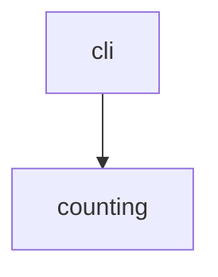

# troy-mode-trial 总体架构

troy-mode-trial 是试用 troy-mode 的临时项目。它统计一段文字里的词数，它的 `wordcount` 命令在命令行里做同样的事。

## 1. 背景和约束

- 除 troy-mode 自己的规则外，无。

## 2. 技术栈

| 部分 | 选择 | 理由 |
| --- | --- | --- |
| 语言 | Python 3.13 | troy-mode 的 Python 语言包。 |
| 命令行程序 | `pyproject.toml` 的 `[project.scripts]` 表里的控制台脚本 `wordcount = "troy_mode_trial.cli:main"`，由现有的构建后端 hatchling 构建。安装工具（uv 或 pip）在环境的脚本文件夹里生成 `wordcount`，在 Windows 上是 `wordcount.exe`。 | 在 Windows 11 和 Linux 上用法相同，不需要第二种语言，也不增加依赖（ADR-0001）。 |
| 参数解析 | 标准库的 `argparse`。 | 需求第 7 节只允许使用标准库（ADR-0001）。 |

## 3. 模块

| 模块 | 负责什么 | 对外接口 | 可以依赖谁 |
| --- | --- | --- | --- |
| counting | `src/troy_mode_trial/__init__.py`、`src/troy_mode_trial/counting.py`。统计一段文字的词数。它是库：不输出任何内容，也不设置退出码。 | `src/troy_mode_trial/__init__.py` | 无 |
| cli | `src/troy_mode_trial/cli.py`。wordcount 程序的命令行：读取参数、调用 counting、写出结果或错误、返回退出码。 | `src/troy_mode_trial/cli.py` | counting |

## 4. 依赖规则

- cli 只通过 `src/troy_mode_trial/__init__.py` 引用 counting，从不引用 `src/troy_mode_trial/counting.py`。
- counting 从不引用 cli。`src/troy_mode_trial/__init__.py` 不导入 `src/troy_mode_trial/cli.py`。
- 没有模块引用 cli。它唯一的调用方是控制台脚本。
- 各模块的 Owns 路径规则互不重叠，所以文件归哪个模块不取决于行的顺序。在 `src/troy_mode_trial/` 下新增文件的设计要写明由哪个模块拥有它，模块表在同一个变更流程里加上这个文件。

## 6. 错误处理

- **counting。** 它把 Python 自己的异常交给调用方，例如 `FileNotFoundError` 或 `UnicodeDecodeError`，不定义自己的异常（需求 Q4）。
- **cli。** 它只捕获 counting 为文件写明的异常：`OSError` 及其子类，以及 `UnicodeDecodeError`。遇到这些异常时，它向标准错误写一行 `wordcount: <按原样输入的 FILE>: <原因>`，并返回退出码 2，因为 Troy 的脚本把退出码 2 当作错误（ADR-0002）。
- 命令行写错时，例如没有文件或给了两个文件，按 `argparse` 的做法在标准错误写一行用法说明，退出码为 2。
- 文件错误和命令行写错共用退出码 2，只有标准错误里的文字能区分它们：文件错误是一行 `wordcount: <按原样输入的 FILE>: <原因>`，命令行写错是用法说明。
- 其他异常都是缺陷，cli 不捕获。Python 向标准错误写出 traceback 并以退出码 1 退出，所以退出码 1 只表示缺陷。
- 成功时，cli 返回退出码 0。
- 原因文字和 `main` 的确切签名由 F04 的设计确定。

## 8. 命名和编码规范

- 标准输出只放程序的结果。对 `wordcount` 来说，就是词数和一个换行。错误和用法说明写到标准错误。
- cli 用 `sys.stdout.write` 和 `sys.stderr.write` 输出，不用 `print()`。ruff 的 T20 规则对整个包保持开启，不按文件豁免。

## 9. 第三方依赖

无。程序只使用标准库（需求第 7 节）。

## 11. 决策记录

| ADR | 标题 | 状态 |
| --- | --- | --- |
| ADR-0001 | `wordcount` 命令放在单独的模块 cli 里 | 已接受（Accepted）。其决定第 4 点中文件错误的退出码由 ADR-0002 取代。 |
| ADR-0002 | `wordcount` 遇到文件错误时以退出码 2 退出 | 已接受（Accepted） |

## 12. 修改记录

| 版本 | 日期 | 修改 |
| --- | --- | --- |
| 1.0 | 2026-11-07 | 第一版，含模块 counting。由 Troy 为 troy-init 的试运行批准。 |
| 1.1 | 2026-11-14 | 为 F04 的 `wordcount` 命令修改（ADR-0001）：技术栈增加 `[project.scripts]` 里的控制台脚本和 `argparse`。模块表增加 cli，counting 的 Owns 缩小到它的两个文件。新增章节：依赖规则、错误处理、标准输出和 `print()` 的规则、第三方依赖、决策记录。 |
| 2.0 | 2026-11-14 | Troy 批准。 |
| 2.1 | 2026-11-14 | Troy 在 PR #39 上的修改（ADR-0002）：cli 遇到文件错误时返回退出码 2 而不是 1，因为 Troy 的脚本把 2 当作错误。第 6 节写明文件错误和命令行写错共用退出码 2，只有标准错误里的文字能区分它们；未捕获的缺陷经 Python 的 traceback 以退出码 1 退出。决策记录把 ADR-0001 列为已接受，其退出码由 ADR-0002 取代，并增加 ADR-0002。 |
| 3.0 | 2026-11-14 | Troy 批准。 |
