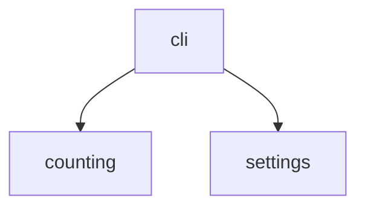

# troy-mode-trial 总体架构

troy-mode-trial 是试用 troy-mode 的临时项目。它统计一段文字里的词数，它的 `wordcount` 命令在命令行里做同样的事。

## 1. 背景和约束

- 除 troy-mode 自己的规则外，无。

## 2. 技术栈

| 部分 | 选择 | 理由 |
| --- | --- | --- |
| 语言 | Python 3.13 | troy-mode 的 Python 语言包。 |
| 命令行程序 | `pyproject.toml` 的 `[project.scripts]` 表里的控制台脚本 `wordcount = "troy_mode_trial.cli:main"`，由现有的构建后端 hatchling 构建。安装工具（uv 或 pip）在环境的脚本文件夹里生成 `wordcount`，在 Windows 上是 `wordcount.exe`。 | 在 Windows 11 和 Linux 上用法相同，不需要第二种语言，也不增加依赖（ADR-0001）。 |
| 参数解析 | 标准库的 `argparse`。 | 需求第 7 节只允许使用标准库（ADR-0001）。 |

## 3. 模块

| 模块 | 负责什么 | 对外接口 | 可以依赖谁 |
| --- | --- | --- | --- |
| counting | `src/troy_mode_trial/__init__.py`、`src/troy_mode_trial/counting.py`。统计一段文字的词数。它是库：不输出任何内容，也不设置退出码。 | `src/troy_mode_trial/__init__.py` | 无 |
| cli | `src/troy_mode_trial/cli.py`。wordcount 程序的命令行：读取参数、调用 counting、写出结果或错误、通过 settings 记下本次运行的选项、返回退出码。 | `src/troy_mode_trial/cli.py` | counting、settings |
| settings | `src/troy_mode_trial/settings.py`。wordcount 程序的设置文件：找到它、读取已保存的选项、写入一次运行的选项（ADR-0003）。它不输出任何内容，也不设置退出码。 | `src/troy_mode_trial/settings.py` | 无 |

## 4. 依赖规则

- cli 只通过 `src/troy_mode_trial/__init__.py` 引用 counting，从不引用 `src/troy_mode_trial/counting.py`。
- cli 通过 `src/troy_mode_trial/settings.py` 引用 settings。
- counting 从不引用 cli 或 settings。`src/troy_mode_trial/__init__.py` 不导入 `src/troy_mode_trial/cli.py` 或 `src/troy_mode_trial/settings.py`，也不从它们导出任何东西，所以库不写任何文件（需求第 7 节）。
- settings 既不引用 counting 也不引用 cli。只有 cli 引用 settings。
- 没有模块引用 cli。它唯一的调用方是控制台脚本。
- 各模块的 Owns 路径规则互不重叠，所以文件归哪个模块不取决于行的顺序。在 `src/troy_mode_trial/` 下新增文件的设计要写明由哪个模块拥有它，模块表在同一个变更流程里加上这个文件。

## 5. 数据模型

程序保存一个文件，即 `wordcount` 的设置文件（ADR-0003）。counting 不保存任何东西。

- **位置。** 在 Windows 上（`sys.platform == "win32"`）是 `<APPDATA>\wordcount\settings.json`。在其他系统上，`XDG_DATA_HOME` 设为绝对路径时是 `<XDG_DATA_HOME>/wordcount/settings.json`，否则是 `~/.local/share/wordcount/settings.json`（需求 Q17）。settings 在每次运行时从环境变量算出路径，从不缓存。
- **内容。** UTF-8 编码的 JSON：一个对象，只有一个键。值为 `null` 表示运行没有计数选项，否则是某个计数选项的名字。F08 的设计确定键名和取值 `lines`、`chars`、`longest`。F09 的设计加上 `sentences`。
- **从不保存的内容。** 文件名、路径、计数或文件里的文字（需求 Q18）。
- **无效内容。** 其他任何内容，例如损坏的 JSON、别的键、多出的键或未知的值，都算无法读取的设置文件（需求 Q20）。文件不存在表示没有已保存的选项。
- **何时写入。** 只有打印出计数的运行才写入，并且在计数和换行已经写到标准输出之后。失败的运行不改动该文件（需求 Q19）。
- **怎样写入。** settings 在 `wordcount` 文件夹不存在时创建它，先把新内容写进同一文件夹里的临时文件，再用 `os.replace` 替换旧文件。写入失败或中断时，旧文件保持完整，或者根本没有文件，绝不会留下写了一半的文件。
- **兼容性。** 这个格式比程序的每个版本都活得久。修改它的设计要说明新版本怎样对待旧版本写的文件，并通过变更流程修改本节。

## 6. 错误处理

- **counting。** 它把 Python 自己的异常交给调用方，例如 `FileNotFoundError` 或 `UnicodeDecodeError`，不定义自己的异常（需求 Q4）。
- **settings。** 它不定义自己的异常。它让 `OSError` 及其子类直接抛出，内容不是已保存的选项时抛出 `ValueError`（`json.JSONDecodeError` 是一种 `ValueError`）。Windows 上没有设置 `APPDATA` 时，算作设置错误，以这两种类型之一抛出，而不是缺陷（ADR-0003）。
- **cli 和 counting。** 在调用 counting 的地方，cli 只捕获 counting 为文件写明的异常：`OSError` 及其子类，以及 `UnicodeDecodeError`。遇到这些异常时，它向标准错误写一行 `wordcount: <按原样输入的 FILE>: <原因>`，并返回退出码 2，因为 Troy 的脚本把退出码 2 当作错误（ADR-0002）。
- **cli 和 settings。** cli 只在调用 settings 的地方捕获 `OSError` 和 `ValueError`，从不在 counting 周围捕获。
  - 为 `--again` 读取已保存的选项：没有已保存的选项，或设置文件无法读取时，在标准错误写一行指出设置文件的错误，退出码 2（需求 Q20）。cli 先读取再计数，所以这样的运行不打印计数。
  - 计数之后写入选项：写入失败时，在标准错误写一行指出设置文件的警告，退出码仍为 0（需求 Q22）。
- 命令行写错时，例如没有文件、给了两个文件，或 `--again` 和某个计数选项一起使用，按 `argparse` 的做法在标准错误写一行用法说明，退出码为 2（需求 Q21）。
- 文件错误、`--again` 的设置错误和命令行写错共用退出码 2，只有标准错误里的文字能区分它们：文件错误是一行 `wordcount: <按原样输入的 FILE>: <原因>`，设置错误是一行指出设置文件的文字，命令行写错是用法说明。
- 其他异常都是缺陷，cli 不捕获。Python 向标准错误写出 traceback 并以退出码 1 退出，所以退出码 1 只表示缺陷。
- 成功时，cli 返回退出码 0，设置文件没能写入时也是如此。
- 原因文字和 `main` 的确切签名由 F04 的设计确定。设置错误和设置警告的文字由 F08 的设计确定。

## 8. 命名和编码规范

- 标准输出只放程序的结果。对 `wordcount` 来说，就是计数和一个换行。错误、用法说明和设置警告写到标准错误。退出码为 0 的运行可以在标准错误写那一行警告，此外不写别的。
- cli 用 `sys.stdout.write` 和 `sys.stderr.write` 输出，不用 `print()`。ruff 的 T20 规则对整个包保持开启，不按文件豁免。
- 只有 settings 打开文件来写，并且只写设置文件和它的临时文件。counting 和 cli 不写任何文件。
- settings 只使用标准库：`json`、`os`、`pathlib` 和 `tempfile`（ADR-0003）。

## 9. 第三方依赖

无。程序只使用标准库（需求第 7 节）。

## 10. 测试设置

- 测试运行器：pytest，带 `--strict-markers`。功能和缺陷的测试放在 `tests/`。版本测试放在 `version-tests/`，在子进程里运行已安装的 `wordcount` 程序。
- 测试怎样标上功能和缺陷编号（R10）：每个测试的名字以它的用例编号或缺陷编号开头，例如 `test_f04_t07_writes_header`。troy-check 读取 JUnit 报告，把尚未验收的功能和尚未修复的缺陷的测试当作预期失败。
- 怎样测量改动代码的覆盖率（R11）：coverage.py 对 `src` 开启分支覆盖，troy-check 读取它的 Cobertura XML 报告。
- 设置隔离（ADR-0003）：任何测试都不读写真正的数据文件夹。`tests/conftest.py` 和 `version-tests/conftest.py` 里各有一个自动夹具（fixture），为每个测试把 `APPDATA` 和 `XDG_DATA_HOME` 设为测试工作文件夹之外的一个新的空文件夹。运行已安装程序的子进程会继承这些变量。测试经理在 F08 的测试计划里加入这两个夹具。

## 11. 决策记录

| ADR | 标题 | 状态 |
| --- | --- | --- |
| ADR-0001 | `wordcount` 命令放在单独的模块 cli 里 | 已接受（Accepted）。其决定第 4 点中文件错误的退出码由 ADR-0002 取代。 |
| ADR-0002 | `wordcount` 遇到文件错误时以退出码 2 退出 | 已接受（Accepted） |
| ADR-0003 | `wordcount` 命令通过新模块 settings 记住上次的选项 | 已接受 （Proposed） |

## 12. 修改记录

| 版本 | 日期 | 修改 |
| --- | --- | --- |
| 1.0 | 2026-11-07 | 第一版，含模块 counting。由 Troy 为 troy-init 的试运行批准。 |
| 1.1 | 2026-11-14 | 为 F04 的 `wordcount` 命令修改（ADR-0001）：技术栈增加 `[project.scripts]` 里的控制台脚本和 `argparse`。模块表增加 cli，counting 的 Owns 缩小到它的两个文件。新增章节：依赖规则、错误处理、标准输出和 `print()` 的规则、第三方依赖、决策记录。 |
| 2.0 | 2026-11-14 | Troy 批准。 |
| 2.1 | 2026-11-14 | Troy 在 PR #39 上的修改（ADR-0002）：cli 遇到文件错误时返回退出码 2 而不是 1，因为 Troy 的脚本把 2 当作错误。第 6 节写明文件错误和命令行写错共用退出码 2，只有标准错误里的文字能区分它们；未捕获的缺陷经 Python 的 traceback 以退出码 1 退出。决策记录把 ADR-0001 列为已接受，其退出码由 ADR-0002 取代，并增加 ADR-0002。 |
| 3.0 | 2026-11-14 | Troy 批准。 |
| 3.1 | 2026-11-26 | 为 F08 的 `--again` 选项修改（ADR-0003）：模块表加上负责设置文件的 settings，cli 可以依赖它。依赖规则加上 `cli --> settings`，并让 counting 和 `__init__.py` 远离 settings。新增第 5 节，写明设置文件的位置、保存什么和从不保存什么，以及怎样写入。第 6 节加上 settings 的异常、`--again` 的设置错误（退出码 2）和设置警告（退出码 0）。第 8 节允许成功的运行写那一行警告，并规定只有 settings 写文件。新增第 10 节，记录测试设置和让测试远离真正数据文件夹的夹具。 |
| 4.0 | 2026-11-26 | Troy 批准。 |
