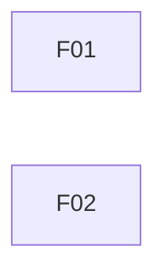

# troy-mode-trial requirements

## 1. Goal

troy-mode-trial is a small Python library that counts things in UTF-8 text files. Troy calls it from Troy's own scripts. Version 0.1 counts the words and the lines of one file.

## 2. Users

Troy is the only user. Troy runs the scripts that call the library on Windows 11 and on Linux, whenever a script needs a count.

## 3. How users interact with it

The library has functions only. It has no command-line program.

1. Troy imports `troy_mode_trial` in a Python script or session.
2. Troy calls a counting function with the path of one UTF-8 text file.
3. The function reads the file and returns the count as an `int`.
4. If the file is missing or is not valid UTF-8, the function raises Python's own exception for that case.

The function names in the prototypes show the flow. The Interface Designer fixes the final names and signatures in each feature's design.

### 3.1 Prototypes

| Prototype | Feature | File |
| --- | --- | --- |
| Count the words of a file | F01 | `docs/prototypes/F01-count-words.md` |
| Count the lines of a file | F02 | `docs/prototypes/F02-count-lines.md` |

## 4. Features

| ID | Feature | Hard dependencies | Soft dependencies | Version | Status |
| --- | --- | --- | --- | --- | --- |
| F01 | Count words: count the words in one UTF-8 text file. A word is a run of characters that are not white space. | None | None | v0.1 | Not started |
| F02 | Count lines: count the lines in one UTF-8 text file. A last line without a line break still counts. | None | None | v0.1 | Not started |

## 5. Dependency graph and order

F01 and F02 do not depend on each other.

Topological order: F01, F02

## 6. Version plan

| Version | Features | What makes it usable on its own |
| --- | --- | --- |
| v0.1 | F01, F02 | Troy's scripts can count the words and the lines of a UTF-8 text file. |

## 7. Non-functional requirements

- The library runs on Python 3.13.
- The library uses the Python standard library only. It has no third-party runtime dependency.
- The library runs on Windows 11 and on Linux, and gives the same counts for the same file on both.
- The library reads files only. It never writes, sends, or stores data.
- The library reads text as UTF-8 only.

### 7.1 Performance targets

None

## 8. Out of scope

- Encodings other than UTF-8.
- Counting a folder of files, or several files in one call.
- A command-line program.

## 9. Open questions

Troy decided these questions in advance for troy-mode's trial. Each decision is the recommended answer.

| ID | Question | Proposal | Decision |
| --- | --- | --- | --- |
| Q1 | Which characters are white space for F01? | The characters for which Python's `str.isspace()` is true, so Unicode white space such as U+3000 also separates words. | Decided by Troy in advance for this trial: as proposed. |
| Q2 | Which line breaks does F02 accept? | `\n`, `\r\n`, and `\r` each end one line. A file from Windows and the same file from Linux give the same count. | Decided by Troy in advance for this trial: as proposed. |
| Q3 | What do the functions return for an empty file? | 0 words and 0 lines. A file that holds only one line break has 1 line and 0 words. | Decided by Troy in advance for this trial: as proposed. |
| Q4 | What happens when the file is missing or is not valid UTF-8? | The function raises Python's own exception, such as `FileNotFoundError` or `UnicodeDecodeError`. It defines no exception of its own. | Decided by Troy in advance for this trial: as proposed. |
| Q5 | Does a UTF-8 byte order mark at the start of the file count as text? | No. The function ignores one byte order mark at the start of the file, so the mark never counts as a word. | Decided by Troy in advance for this trial: as proposed. |
| Q6 | The architecture 1.0 says that the module `counting` counts the words of a text. Does F02 need an architecture change? | No. `counting` owns `src/troy_mode_trial/**`, and counting lines is counting too. F02 fits the module as it is. | Decided by Troy in advance for this trial: as proposed. |

## 10. Change log

| Version | Date | Change |
| --- | --- | --- |
| 0.1 | 2026-11-07 | First draft. |
