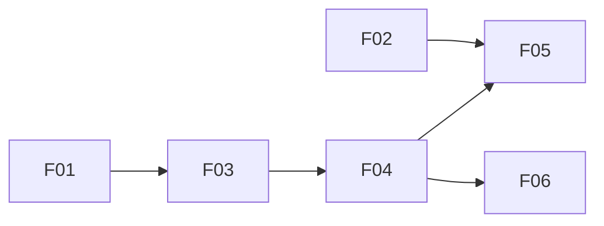

# troy-mode-trial requirements

## 1. Goal

troy-mode-trial is a small Python library that counts things in UTF-8 text files. Troy calls it from Troy's own scripts, and runs its `wordcount` command in PowerShell. Version 0.1 counts the words of one file. Version 0.2 adds the `wordcount` command and also counts the lines of a file. Version 0.3 adds the `--lines` and `--chars` options, so `wordcount` can also print the lines or the characters of a file.

## 2. Users

Troy is the only user. Troy runs the scripts that call the library on Windows 11 and on Linux, whenever a script needs a count.

## 3. How users interact with it

The library has functions, and one command-line program, `wordcount` (F04, with the `--lines` option of F05 and the `--chars` option of F06).

1. Troy imports `troy_mode_trial` in a Python script or session.
2. Troy calls a counting function with the path of one UTF-8 text file.
3. The function reads the file and returns the count as an `int`.
4. If the file is missing or is not valid UTF-8, the function raises Python's own exception for that case.

The function names in the prototypes show the flow. The Interface Designer fixes the final names and signatures in each feature's design.

To count words outside Python, Troy types `wordcount FILE` in PowerShell. The command prints the number of words in the file, counted as F03 counts them. If the file is missing, it prints an error that names the file and exits with a code that is not 0.

To count lines outside Python, Troy types `wordcount --lines FILE`. The command prints the number of lines in the file, counted as F02 counts them, instead of its words. A missing file gives the same error and exit code as without the option.

To count characters outside Python, Troy types `wordcount --chars FILE`. The command prints the number of characters of the file's decoded text, line ends included, instead of its words. A file error gives the same message and exit code as `wordcount FILE`.

### 3.1 Prototypes

| Prototype | Feature | File |
| --- | --- | --- |
| Count the words of a file | F01 | `docs/prototypes/F01-count-words.md` |
| Count the lines of a file | F02 | `docs/prototypes/F02-count-lines.md` |
| Skip runs without a letter or digit | F03 | `docs/prototypes/F03-words-need-a-letter-or-digit.md` |
| Count words in PowerShell | F04 | `docs/prototypes/F04-word-count-command.md` |
| Count lines in PowerShell | F05 | `docs/prototypes/F05-line-count-option.md` |
| Count characters in PowerShell | F06 | `docs/prototypes/F06-character-count-option.md` |

## 4. Features

| ID | Feature | Hard dependencies | Soft dependencies | Version | Status |
| --- | --- | --- | --- | --- | --- |
| F01 | Count words | None | None | v0.1 | Usable on Troy's devices |
| F02 | Count lines | None | None | v0.2 | Usable on Troy's devices |
| F03 | Words need a letter or digit | F01 | None | v0.1 | Usable on Troy's devices |
| F04 | Word count command | F03 | None | v0.2 | Usable on Troy's devices |
| F05 | Line count option | F02, F04 | None | v0.3 | Not started |
| F06 | Character count option | F04 | None | v0.3 | Not started |

### 4.1 What each feature does

- **F01 Count words.** Counts the words in one UTF-8 text file. A word is a run of characters that are not white space.
- **F02 Count lines.** Counts the lines in one UTF-8 text file. A last line without a line break still counts.
- **F03 Words need a letter or digit.** Changes F01's word: a word is a run of characters that are not white space and that holds at least one letter or digit, that is, at least one character for which Python's `str.isalnum()` is true. A run of other characters only, such as `--` or `...`, is not a word. A run such as `don't`, `x--y`, or `3.14` is still one word.
- **F04 Word count command.** Gives Troy a `wordcount FILE` command in PowerShell. It prints the number of words in one UTF-8 text file, counted as F03 counts them, so Troy can count words outside Python. If the file is missing, it prints an error that names the file, and its exit code is not 0.
- **F05 Line count option.** Adds the `--lines` option to `wordcount`: `wordcount --lines FILE` prints the number of lines in one UTF-8 text file, counted as F02 counts them, instead of its words. `wordcount FILE` without the option still prints the words. A missing file gives the same error and exit code as `wordcount FILE`.
- **F06 Character count option.** Adds the `--chars` option to `wordcount`: `wordcount --chars FILE` prints the number of characters of one UTF-8 text file instead of its words. It counts the characters of the file's decoded text, line ends included: a character is one Unicode code point, so `你` is one character, not three bytes, and a Windows line end `\r\n` is two characters. A byte order mark at the start of the file is not counted (Q12). A missing file, or a file that is not valid UTF-8, gives the same error message and exit code as `wordcount FILE`.

## 5. Dependency graph and order

F03 changes F01's word, so F03 has a hard dependency on F01. F04 counts words as F03 counts them, so F04 has a hard dependency on F03. F02 depends on none of them. F05 adds an option to F04's command and counts lines as F02 counts them, so F05 has a hard dependency on F02 and on F04. F06 adds an option to F04's command and needs no other feature, so F06 has a hard dependency on F04 only. F05 and F06 do not depend on each other, so they can be built at the same time.

Topological order: F01, F03, F04, F06, F02, F05

## 6. Version plan

| Version | Features | What makes it usable on its own |
| --- | --- | --- |
| v0.1 | F01, F03 | Troy's scripts can count the words of a UTF-8 text file, where a word holds at least one letter or digit. |
| v0.2 | F04, F02 | Troy can count the words of a UTF-8 text file with the `wordcount` command in PowerShell, and Troy's scripts can also count the lines of a UTF-8 text file. |
| v0.3 | F05, F06 | Troy can count the lines of a UTF-8 text file with `wordcount --lines`, and its characters with `wordcount --chars`, in PowerShell. |

## 7. Non-functional requirements

- The library runs on Python 3.13.
- The library uses the Python standard library only. It has no third-party runtime dependency.
- The library runs on Windows 11 and on Linux, and gives the same counts for the same file on both.
- The library reads files only. It never writes, sends, or stores data.
- The library reads text as UTF-8 only.

### 7.1 Performance targets

None

## 8. Out of scope

- Encodings other than UTF-8.
- Counting a folder of files, or several files in one call.
- Any command-line program other than `wordcount`, any `wordcount` option other than `--lines` and `--chars`, two counting options in one command, and a second file argument.

## 9. Open questions

Troy decided these questions in advance for troy-mode's trial. Each decision is the recommended answer.

| ID | Question | Proposal | Decision |
| --- | --- | --- | --- |
| Q1 | Which characters are white space for F01? | The characters for which Python's `str.isspace()` is true, so Unicode white space such as U+3000 also separates words. | Decided by Troy in advance for this trial: as proposed. |
| Q2 | Which line breaks does F02 accept? | `\n`, `\r\n`, and `\r` each end one line. A file from Windows and the same file from Linux give the same count. | Decided by Troy in advance for this trial: as proposed. |
| Q3 | What do the functions return for an empty file? | 0 words and 0 lines. A file that holds only one line break has 1 line and 0 words. | Decided by Troy in advance for this trial: as proposed. |
| Q4 | What happens when the file is missing or is not valid UTF-8? | The function raises Python's own exception, such as `FileNotFoundError` or `UnicodeDecodeError`. It defines no exception of its own. | Decided by Troy in advance for this trial: as proposed. |
| Q5 | Does a UTF-8 byte order mark at the start of the file count as text? | No. The function ignores one byte order mark at the start of the file, so the mark never counts as a word. | Decided by Troy in advance for this trial: as proposed. |
| Q6 | The architecture 1.0 says that the module `counting` counts the words of a text. Does F02 need an architecture change? | No. `counting` owns `src/troy_mode_trial/**`, and counting lines is counting too. F02 fits the module as it is. | Decided by Troy in advance for this trial: as proposed. |
| Q7 | Does F05's option also get a short form, such as `-l`? | No. Only `--lines`, as Troy asked; a short form can come later as its own change. | Decided by Troy on 2026-11-17: as proposed ("全按推荐"). |
| Q8 | What does `wordcount --lines` print for a missing file, or a file that is not valid UTF-8? | The same error message and exit code as `wordcount FILE` gives for that file. | Decided by Troy on 2026-11-17: as proposed ("全按推荐"). |
| Q9 | When is F05 built? | After v0.2 is released, so the v0.2 release holds only F02 and F04. | Decided by Troy on 2026-11-17: as proposed ("全按推荐"). |
| Q10 | Does F06's option also get a short form, such as `-c`? | No. Only `--chars`, as for `--lines` (Q7). | Decided by Troy on 2026-11-23: as proposed ("全按推荐"). |
| Q11 | How many characters is a Windows line end `\r\n`? | Two, as the file holds them. `wordcount --chars` counts the decoded text as it is, with no line-end translation, so the same file gives the same count on Windows and on Linux. | Decided by Troy on 2026-11-23: as proposed ("全按推荐"). |
| Q12 | Does a byte order mark at the start of the file count as a character? | No, as for words (Q5). | Decided by Troy on 2026-11-23: as proposed ("全按推荐"). |
| Q13 | What does `wordcount --lines --chars FILE` do? | A usage error with exit code 2, as for any other wrong command line: one command prints one count. | Decided by Troy on 2026-11-23: as proposed ("全按推荐"). |

## 10. Change log

| Version | Date | Change |
| --- | --- | --- |
| 0.1 | 2026-11-07 | First draft. |
| 1.1 | 2026-11-07 | F01 accepted: its status is now Passes tests on main. |
| 1.2 | 2026-11-07 | A word must hold at least one letter or digit (`str.isalnum()`). F01 is accepted, so the change is the new feature F03, with a hard dependency on F01. The Feature cells of F01 and F02 hold only their short names; section 4.1 describes each feature. |
| 2.1 | 2026-11-08 | F02 moves to the new version v0.2, so v0.1 holds F01 and F03. The version plan adds v0.2. F02's behavior does not change, and F01 and F03 do not change. |
| 3.0 | 2026-11-08 | Approved by Troy. |
| 3.1 | 2026-11-08 | F03 accepted: its status is now Passes tests on main. |
| 3.2 | 2026-11-08 | Troy accepted v0.1.0 on Troy's PC: F01 and F03 are now Usable on Troy's devices. |
| 3.3 | 2026-11-14 | The new feature F04, Word count command: a `wordcount FILE` command in PowerShell that prints the words of one UTF-8 text file, counted as F03 counts them. F04 has a hard dependency on F03, comes before F02 in the order (F01, F03, F04, F02), and is in v0.2 with F02. Its prototype is `docs/prototypes/F04-word-count-command.md`. Sections 1, 3, and 8 no longer rule out a command-line program. F01, F02, and F03 do not change. |
| 4.0 | 2026-11-14 | Approved by Troy. |
| 4.1 | 2026-11-15 | F04 accepted: its status is now Ran for real on Troy's PC. |
| 4.2 | 2026-11-17 | F02 accepted: its status is now Passes tests on main. F02 is a library function with no command of its own to run for real. |
| 4.3 | 2026-11-17 | The new feature F05, Line count option: `wordcount --lines FILE` prints the lines of one UTF-8 text file, counted as F02 counts them. F02 and F04 are accepted and do not change, so F05 is a new feature with a hard dependency on both, last in the order (F01, F03, F04, F02, F05), in the new version v0.3. Its prototype is `docs/prototypes/F05-line-count-option.md`. Section 8 allows the `--lines` option. New questions Q7 to Q9. From Troy's idea #51. |
| 5.0 | 2026-11-17 | Approved by Troy. |
| 5.1 | 2026-11-17 | Troy accepted v0.2.0 on Troy's PC: F02 and F04 are now Usable on Troy's devices. |
| 5.2 | 2026-11-23 | The new feature F06, Character count option: `wordcount --chars FILE` prints the characters of one UTF-8 text file, its decoded text with line ends included. F04 is accepted and does not change, so F06 is a new feature with a hard dependency on F04 only, right after F04 in the order (F01, F03, F04, F06, F02, F05), in v0.3 beside F05. Its prototype is `docs/prototypes/F06-character-count-option.md`. Section 8 allows the `--chars` option. New questions Q10 to Q13. F01 to F05 do not change. |
| 6.0 | 2026-11-23 | Approved by Troy. |
