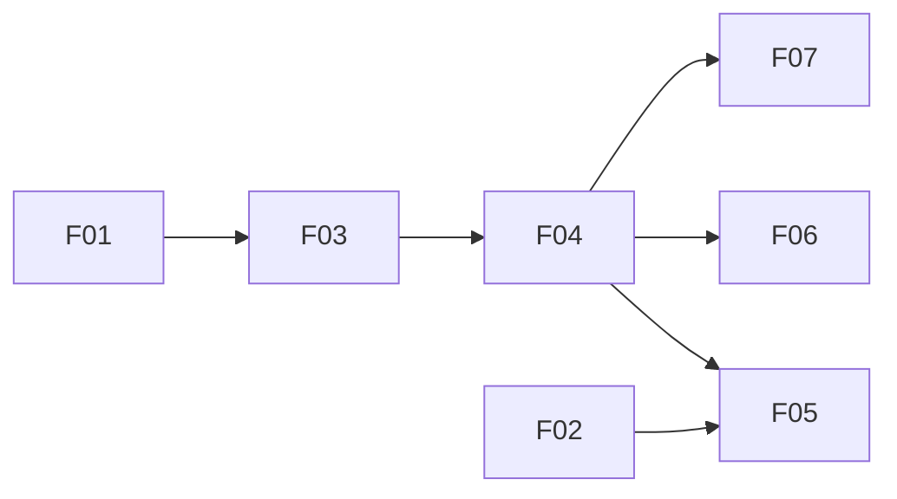

# troy-mode-trial 需求文档

## 1. 目标

troy-mode-trial 是一个小型 Python 库，用来统计 UTF-8 文本文件里的内容。Troy 在自己的脚本里调用它，也在 PowerShell 里运行它的 `wordcount` 命令。0.1 版统计一个文件的词数，0.2 版加上 `wordcount` 命令，并统计一个文件的行数。0.3 版加上 `--lines`、`--chars` 和 `--longest` 选项，让 `wordcount` 也能打印一个文件的行数、字符数，或其中最长的词的长度。

## 2. 用户

唯一的用户是 Troy。Troy 在 Windows 11 和 Linux 上运行调用这个库的脚本，脚本需要计数时就用它。

## 3. 用户如何使用

这个库提供函数，以及一个命令行程序 `wordcount`（F04，以及 F05 的 `--lines` 选项、F06 的 `--chars` 选项和 F07 的 `--longest` 选项）。

1. Troy 在 Python 脚本或会话里导入 `troy_mode_trial`。
2. Troy 调用一个计数函数，传入一个 UTF-8 文本文件的路径。
3. 函数读取文件，以 `int` 返回计数。
4. 文件不存在或不是合法的 UTF-8 时，函数抛出 Python 自带的对应异常。

原型里的函数名只用来展示流程。最终的函数名和签名由界面设计师在各功能的设计里确定。

要在 Python 之外统计词数，Troy 在 PowerShell 里输入 `wordcount FILE`。命令打印文件里的词数，按 F03 的方式计数。文件不存在时，它打印一条写明文件名的错误，退出码不为 0。

要在 Python 之外统计行数，Troy 输入 `wordcount --lines FILE`。命令打印文件里的行数，按 F02 的方式计数，而不是词数。文件不存在时，错误和退出码与不带选项时相同。

要在 Python 之外统计字符数，Troy 输入 `wordcount --chars FILE`。命令打印文件解码后的文本里的字符数（换行符也算），而不是词数。文件出错时，错误信息和退出码与 `wordcount FILE` 相同。

要在 Python 之外找出最长的词有多长，Troy 输入 `wordcount --longest FILE`。命令打印文件里最长的词的长度（按字符计），词按 F03 的方式划分，而不是词数。文件里没有词时打印 0。文件出错时，错误信息和退出码与 `wordcount FILE` 相同。

### 3.1 原型

| 原型 | 功能 | 文件 |
| --- | --- | --- |
| 统计一个文件的词数 | F01 | `docs/prototypes/F01-count-words.md` |
| 统计一个文件的行数 | F02 | `docs/prototypes/F02-count-lines.md` |
| 跳过不含字母或数字的串 | F03 | `docs/prototypes/F03-words-need-a-letter-or-digit.md` |
| 在 PowerShell 里统计词数 | F04 | `docs/prototypes/F04-word-count-command.md` |
| 在 PowerShell 里统计行数 | F05 | `docs/prototypes/F05-line-count-option.md` |
| 在 PowerShell 里统计字符数 | F06 | `docs/prototypes/F06-character-count-option.md` |
| 在 PowerShell 里找出最长的词 | F07 | `docs/prototypes/F07-longest-word-option.md` |

## 4. 功能点

| 编号 | 功能 | 硬依赖 | 软依赖 | 版本 | 状态 |
| --- | --- | --- | --- | --- | --- |
| F01 | Count words | 无 | 无 | v0.1 | 可在 Troy 的设备上使用 |
| F02 | Count lines | 无 | 无 | v0.2 | 可在 Troy 的设备上使用 |
| F03 | Words need a letter or digit | F01 | 无 | v0.1 | 可在 Troy 的设备上使用 |
| F04 | Word count command | F03 | 无 | v0.2 | 可在 Troy 的设备上使用 |
| F05 | Line count option | F02, F04 | 无 | v0.3 | 在 Troy 的电脑上真跑过 |
| F06 | Character count option | F04 | 无 | v0.3 | 在 Troy 的电脑上真跑过 |
| F07 | Longest word option | F04 | 无 | v0.3 | 未开始 |

功能列保留英文短名，因为它就是 PR 标题和功能文件夹的名字。

### 4.1 各功能做什么

- **F01 Count words（统计词数）。** 统计一个 UTF-8 文本文件里的词数。一个词是一串连续的非空白字符。
- **F02 Count lines（统计行数）。** 统计一个 UTF-8 文本文件里的行数。最后一行没有换行符也算一行。
- **F03 Words need a letter or digit（词须含字母或数字）。** 修改 F01 对词的定义：一个词是一串连续的非空白字符，并且至少含一个字母或数字，即至少一个使 Python 的 `str.isalnum()` 为真的字符。只由其他字符组成的串，例如 `--` 或 `...`，不是词。`don't`、`x--y`、`3.14` 这样的串仍是一个词。
- **F04 Word count command（词数命令）。** 给 Troy 一个在 PowerShell 里使用的 `wordcount FILE` 命令。它打印一个 UTF-8 文本文件里的词数，按 F03 的方式计数，让 Troy 在 Python 之外也能统计词数。文件不存在时，它打印一条写明文件名的错误，退出码不为 0。
- **F05 Line count option（行数选项）。** 给 `wordcount` 加上 `--lines` 选项：`wordcount --lines FILE` 打印一个 UTF-8 文本文件里的行数，按 F02 的方式计数，而不是词数。不带选项的 `wordcount FILE` 仍然打印词数。文件不存在时，错误和退出码与 `wordcount FILE` 相同。
- **F06 Character count option（字符数选项）。** 给 `wordcount` 加上 `--chars` 选项：`wordcount --chars FILE` 打印一个 UTF-8 文本文件的字符数，而不是词数。它统计文件解码后的文本里的字符，换行符也算：一个字符是一个 Unicode 码位，所以 `你` 是一个字符，不是三个字节；Windows 的换行 `\r\n` 是两个字符。文件开头的字节顺序标记不算（Q12）。文件不存在或不是合法的 UTF-8 时，错误信息和退出码与 `wordcount FILE` 相同。
- **F07 Longest word option（最长词选项）。** 给 `wordcount` 加上 `--longest` 选项：`wordcount --longest FILE` 打印一个 UTF-8 文本文件里最长的词的长度（按字符计），而不是词数。词就是 F03 算作词的东西，即整串连续的非空白字符，所以 `don't,` 长 6 个字符（Q15）。一个字符是一个 Unicode 码位，与 `--chars` 一样，所以 `世界!` 长 3 个字符。没有词的文件，例如空文件或只有 `--` 和 `...` 的文件，打印 0。文件开头的字节顺序标记不算词的一部分（Q5）。文件不存在或不是合法的 UTF-8 时，错误信息和退出码与 `wordcount FILE` 相同。

## 5. 依赖图和顺序

F03 修改 F01 对词的定义，所以 F03 硬依赖 F01。F04 按 F03 的方式计数，所以 F04 硬依赖 F03。F02 不依赖其他功能。F05 给 F04 的命令加选项，并按 F02 的方式数行，所以 F05 硬依赖 F02 和 F04。F06 给 F04 的命令加选项，不需要其他功能，所以 F06 只硬依赖 F04。F07 给 F04 的命令加选项，并按 F04 的方式划分词，所以 F07 只硬依赖 F04。F05、F06 和 F07 互不依赖。

拓扑顺序：F01, F03, F04, F07, F06, F02, F05

## 6. 版本计划

| 版本 | 功能 | 凭什么能单独使用 |
| --- | --- | --- |
| v0.1 | F01, F03 | Troy 的脚本可以统计一个 UTF-8 文本文件的词数，其中每个词至少含一个字母或数字。 |
| v0.2 | F04, F02 | Troy 可以在 PowerShell 里用 `wordcount` 命令统计一个 UTF-8 文本文件的词数，Troy 的脚本还可以统计一个 UTF-8 文本文件的行数。 |
| v0.3 | F05, F06, F07 | Troy 可以在 PowerShell 里用 `wordcount --lines` 统计一个 UTF-8 文本文件的行数，用 `wordcount --chars` 统计它的字符数，用 `wordcount --longest` 找出它最长的词有多长。 |

## 7. 非功能需求

- 这个库在 Python 3.13 上运行。
- 这个库只用 Python 标准库，运行时没有第三方依赖。
- 这个库在 Windows 11 和 Linux 上都能运行，同一个文件在两个系统上的计数相同。
- 这个库只读文件，从不写入、发送或保存数据。
- 这个库只按 UTF-8 读取文本。

### 7.1 性能指标

无

## 8. 不做的范围

- UTF-8 以外的编码。
- 统计一个文件夹里的文件，或一次调用统计多个文件。
- `wordcount` 以外的命令行程序，`--lines`、`--chars` 和 `--longest` 以外的任何 `wordcount` 选项，一条命令里同时用其中两个选项，打印最长的词本身，以及第二个文件参数。

## 9. 待定问题

这些问题由 Troy 为 troy-mode 的试运行事先决定：每个决定都采用推荐的答案。

| 编号 | 问题 | 提议 | 决定 |
| --- | --- | --- | --- |
| Q1 | F01 把哪些字符当作空白？ | Python 的 `str.isspace()` 为真的字符，所以 U+3000 等 Unicode 空白也分隔词。 | Troy 为本次试运行事先决定：按提议。 |
| Q2 | F02 接受哪些换行符？ | `\n`、`\r\n` 和 `\r` 各结束一行。同一个文件来自 Windows 或 Linux，计数相同。 | Troy 为本次试运行事先决定：按提议。 |
| Q3 | 空文件返回什么？ | 0 个词、0 行。只含一个换行符的文件有 1 行、0 个词。 | Troy 为本次试运行事先决定：按提议。 |
| Q4 | 文件不存在或不是合法的 UTF-8 时怎么办？ | 函数抛出 Python 自带的异常，例如 `FileNotFoundError` 或 `UnicodeDecodeError`，不定义自己的异常。 | Troy 为本次试运行事先决定：按提议。 |
| Q5 | 文件开头的 UTF-8 字节顺序标记算不算文本？ | 不算。函数忽略文件开头的一个字节顺序标记，所以它永远不会被算成一个词。 | Troy 为本次试运行事先决定：按提议。 |
| Q6 | 架构 1.0 说模块 `counting` 统计一段文字的词数。F02 需要修改架构吗？ | 不需要。`counting` 拥有 `src/troy_mode_trial/**`，统计行数也是计数。F02 放在现有模块里即可。 | Troy 为本次试运行事先决定：按提议。 |
| Q7 | F05 的选项要不要再加一个短写法，例如 `-l`？ | 不要。只有 `--lines`，和 Troy 提的一样；短写法以后可以作为单独的修改再加。 | Troy 于 2026-11-17 决定：按提议（“全按推荐”）。 |
| Q8 | 文件不存在或不是合法的 UTF-8 时，`wordcount --lines` 打印什么？ | 与 `wordcount FILE` 对同一个文件给出的错误信息和退出码相同。 | Troy 于 2026-11-17 决定：按提议（“全按推荐”）。 |
| Q9 | F05 什么时候开发？ | 在 v0.2 发布之后，这样 v0.2 只包含 F02 和 F04。 | Troy 于 2026-11-17 决定：按提议（“全按推荐”）。 |
| Q10 | F06 的选项要不要再加一个短写法，例如 `-c`？ | 不要。只有 `--chars`，与 `--lines` 一样（Q7）。 | Troy 于 2026-11-23 决定：按提议（“全按推荐”）。 |
| Q11 | Windows 的换行 `\r\n` 算几个字符？ | 两个，按文件里的原样计算。`wordcount --chars` 按解码后的文本原样计数，不转换换行符，所以同一个文件在 Windows 和 Linux 上计数相同。 | Troy 于 2026-11-23 决定：按提议（“全按推荐”）。 |
| Q12 | 文件开头的字节顺序标记算不算一个字符？ | 不算，与统计词数时一样（Q5）。 | Troy 于 2026-11-23 决定：按提议（“全按推荐”）。 |
| Q13 | `wordcount --lines --chars FILE` 会怎样？ | 用法错误，退出码 2，与其他错误的命令行一样：一条命令只打印一个计数。 | Troy 于 2026-11-23 决定：按提议（“全按推荐”）。 |
| Q14 | F07 的选项要不要再加一个短写法，例如 `-L`？ | 不要。只有 `--longest`，与 `--lines` 和 `--chars` 一样（Q7、Q10）。 | Troy 于 2026-11-25 决定：按提议（“全按推荐”）。 |
| Q15 | 紧贴在词上的标点算不算词的长度，例如 `don't,` 里的逗号？ | 算。词就是 F03 数的整串字符，这样 `wordcount --longest` 和 `wordcount` 对“词”的理解一致。 | Troy 于 2026-11-25 决定：按提议（“全按推荐”）。 |
| Q16 | `wordcount --longest` 和 `--lines` 或 `--chars` 一起用会怎样？ | 用法错误，退出码 2，与 `--lines --chars` 一样（Q13）。 | Troy 于 2026-11-25 决定：按提议（“全按推荐”）。 |

## 10. 修改记录

| 版本 | 日期 | 修改 |
| --- | --- | --- |
| 0.1 | 2026-11-07 | 初稿。 |
| 1.1 | 2026-11-07 | F01 通过验收：状态改为在 main 上通过测试。 |
| 1.2 | 2026-11-07 | 一个词必须至少含一个字母或数字（`str.isalnum()`）。F01 已通过验收，所以这项修改作为新功能 F03，硬依赖 F01。F01 和 F02 的功能列只保留短名；第 4.1 节描述每个功能。 |
| 2.1 | 2026-11-08 | F02 移到新版本 v0.2，所以 v0.1 只含 F01 和 F03。版本计划加上 v0.2。F02 的行为不变，F01 和 F03 也不变。 |
| 3.0 | 2026-11-08 | Troy 批准。 |
| 3.1 | 2026-11-08 | F03 通过验收：状态改为在 main 上通过测试。 |
| 3.2 | 2026-11-08 | Troy 在自己的电脑上验收了 v0.1.0：F01 和 F03 的状态改为可在 Troy 的设备上使用。 |
| 3.3 | 2026-11-14 | 新功能 F04，Word count command：在 PowerShell 里使用的 `wordcount FILE` 命令，打印一个 UTF-8 文本文件的词数，按 F03 的方式计数。F04 硬依赖 F03，在顺序里排在 F02 之前（F01, F03, F04, F02），与 F02 同属 v0.2。它的原型是 `docs/prototypes/F04-word-count-command.md`。第 1、3、8 节不再排除命令行程序。F01、F02 和 F03 不变。 |
| 4.0 | 2026-11-14 | Troy 批准。 |
| 4.1 | 2026-11-15 | F04 通过验收：状态改为在 Troy 的电脑上真跑过。 |
| 4.2 | 2026-11-17 | F02 通过验收：状态改为在 main 上通过测试。F02 是库函数，没有可以真跑的命令。 |
| 4.3 | 2026-11-17 | 新功能 F05，Line count option：`wordcount --lines FILE` 打印一个 UTF-8 文本文件的行数，按 F02 的方式计数。F02 和 F04 已经验收，保持不变，所以 F05 是新功能，硬依赖这两个功能，排在顺序最后（F01, F03, F04, F02, F05），属于新版本 v0.3。它的原型是 `docs/prototypes/F05-line-count-option.md`。第 8 节允许 `--lines` 选项。新增问题 Q7 到 Q9。来自 Troy 的 idea #51。 |
| 5.0 | 2026-11-17 | Troy 批准。 |
| 5.1 | 2026-11-17 | Troy 在自己的电脑上验收了 v0.2.0：F02 和 F04 的状态改为可在 Troy 的设备上使用。 |
| 5.2 | 2026-11-23 | 新功能 F06，Character count option：`wordcount --chars FILE` 打印一个 UTF-8 文本文件的字符数，即解码后的文本，换行符也算。F04 已经验收，保持不变，所以 F06 是新功能，只硬依赖 F04，在顺序里紧跟 F04（F01, F03, F04, F06, F02, F05），与 F05 同属 v0.3。它的原型是 `docs/prototypes/F06-character-count-option.md`。第 8 节允许 `--chars` 选项。新增问题 Q10 到 Q13。F01 到 F05 不变。 |
| 6.0 | 2026-11-23 | Troy 批准。 |
| 6.1 | 2026-11-23 | F06 通过验收：状态改为在 Troy 的电脑上真跑过。 |
| 6.2 | 2026-11-23 | F05 通过验收：状态改为在 Troy 的电脑上真跑过。 |
| 6.3 | 2026-11-25 | 新功能 F07，Longest word option：`wordcount --longest FILE` 打印一个 UTF-8 文本文件里最长的词的长度（按字符计），词按 F03 的方式划分，没有词的文件打印 0。F04 已经验收，保持不变，所以 F07 是新功能，只硬依赖 F04，在顺序里紧跟 F04（F01, F03, F04, F07, F06, F02, F05），与 F05 和 F06 同属 v0.3。它的原型是 `docs/prototypes/F07-longest-word-option.md`。第 8 节允许 `--longest` 选项。新增问题 Q14 到 Q16。F01 到 F06 不变。 |
| 7.0 | 2026-11-25 | Troy 批准。 |
