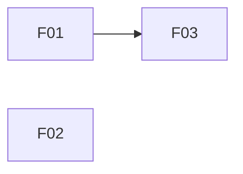

# troy-mode-trial 需求文档

## 1. 目标

troy-mode-trial 是一个小型 Python 库，用来统计 UTF-8 文本文件里的内容。Troy 在自己的脚本里调用它。0.1 版统计一个文件的词数，0.2 版再加上它的行数。

## 2. 用户

唯一的用户是 Troy。Troy 在 Windows 11 和 Linux 上运行调用这个库的脚本，脚本需要计数时就用它。

## 3. 用户如何使用

这个库只提供函数，没有命令行程序。

1. Troy 在 Python 脚本或会话里导入 `troy_mode_trial`。
2. Troy 调用一个计数函数，传入一个 UTF-8 文本文件的路径。
3. 函数读取文件，以 `int` 返回计数。
4. 文件不存在或不是合法的 UTF-8 时，函数抛出 Python 自带的对应异常。

原型里的函数名只用来展示流程。最终的函数名和签名由界面设计师在各功能的设计里确定。

### 3.1 原型

| 原型 | 功能 | 文件 |
| --- | --- | --- |
| 统计一个文件的词数 | F01 | `docs/prototypes/F01-count-words.md` |
| 统计一个文件的行数 | F02 | `docs/prototypes/F02-count-lines.md` |
| 跳过不含字母或数字的串 | F03 | `docs/prototypes/F03-words-need-a-letter-or-digit.md` |

## 4. 功能点

| 编号 | 功能 | 硬依赖 | 软依赖 | 版本 | 状态 |
| --- | --- | --- | --- | --- | --- |
| F01 | Count words | 无 | 无 | v0.1 | 在 main 上通过测试 |
| F02 | Count lines | 无 | 无 | v0.2 | 未开始 |
| F03 | Words need a letter or digit | F01 | 无 | v0.1 | 未开始 |

功能列保留英文短名，因为它就是 PR 标题和功能文件夹的名字。

### 4.1 各功能做什么

- **F01 Count words（统计词数）。** 统计一个 UTF-8 文本文件里的词数。一个词是一串连续的非空白字符。
- **F02 Count lines（统计行数）。** 统计一个 UTF-8 文本文件里的行数。最后一行没有换行符也算一行。
- **F03 Words need a letter or digit（词须含字母或数字）。** 修改 F01 对词的定义：一个词是一串连续的非空白字符，并且至少含一个字母或数字，即至少一个使 Python 的 `str.isalnum()` 为真的字符。只由其他字符组成的串，例如 `--` 或 `...`，不是词。`don't`、`x--y`、`3.14` 这样的串仍是一个词。

## 5. 依赖图和顺序

F03 修改 F01 对词的定义，所以 F03 硬依赖 F01。F02 不依赖其他功能。

拓扑顺序：F01, F03, F02

## 6. 版本计划

| 版本 | 功能 | 凭什么能单独使用 |
| --- | --- | --- |
| v0.1 | F01, F03 | Troy 的脚本可以统计一个 UTF-8 文本文件的词数，其中每个词至少含一个字母或数字。 |
| v0.2 | F02 | Troy 的脚本还可以统计一个 UTF-8 文本文件的行数。 |

## 7. 非功能需求

- 这个库在 Python 3.13 上运行。
- 这个库只用 Python 标准库，运行时没有第三方依赖。
- 这个库在 Windows 11 和 Linux 上都能运行，同一个文件在两个系统上的计数相同。
- 这个库只读文件，从不写入、发送或保存数据。
- 这个库只按 UTF-8 读取文本。

### 7.1 性能指标

无

## 8. 不做的范围

- UTF-8 以外的编码。
- 统计一个文件夹里的文件，或一次调用统计多个文件。
- 命令行程序。

## 9. 待定问题

这些问题由 Troy 为 troy-mode 的试运行事先决定：每个决定都采用推荐的答案。

| 编号 | 问题 | 提议 | 决定 |
| --- | --- | --- | --- |
| Q1 | F01 把哪些字符当作空白？ | Python 的 `str.isspace()` 为真的字符，所以 U+3000 等 Unicode 空白也分隔词。 | Troy 为本次试运行事先决定：按提议。 |
| Q2 | F02 接受哪些换行符？ | `\n`、`\r\n` 和 `\r` 各结束一行。同一个文件来自 Windows 或 Linux，计数相同。 | Troy 为本次试运行事先决定：按提议。 |
| Q3 | 空文件返回什么？ | 0 个词、0 行。只含一个换行符的文件有 1 行、0 个词。 | Troy 为本次试运行事先决定：按提议。 |
| Q4 | 文件不存在或不是合法的 UTF-8 时怎么办？ | 函数抛出 Python 自带的异常，例如 `FileNotFoundError` 或 `UnicodeDecodeError`，不定义自己的异常。 | Troy 为本次试运行事先决定：按提议。 |
| Q5 | 文件开头的 UTF-8 字节顺序标记算不算文本？ | 不算。函数忽略文件开头的一个字节顺序标记，所以它永远不会被算成一个词。 | Troy 为本次试运行事先决定：按提议。 |
| Q6 | 架构 1.0 说模块 `counting` 统计一段文字的词数。F02 需要修改架构吗？ | 不需要。`counting` 拥有 `src/troy_mode_trial/**`，统计行数也是计数。F02 放在现有模块里即可。 | Troy 为本次试运行事先决定：按提议。 |

## 10. 修改记录

| 版本 | 日期 | 修改 |
| --- | --- | --- |
| 0.1 | 2026-11-07 | 初稿。 |
| 1.1 | 2026-11-07 | F01 通过验收：状态改为在 main 上通过测试。 |
| 1.2 | 2026-11-07 | 一个词必须至少含一个字母或数字（`str.isalnum()`）。F01 已通过验收，所以这项修改作为新功能 F03，硬依赖 F01。F01 和 F02 的功能列只保留短名；第 4.1 节描述每个功能。 |
| 2.1 | 2026-11-08 | F02 移到新版本 v0.2，所以 v0.1 只含 F01 和 F03。版本计划加上 v0.2。F02 的行为不变，F01 和 F03 也不变。 |
| 3.0 | 2026-11-08 | Troy 批准。 |
